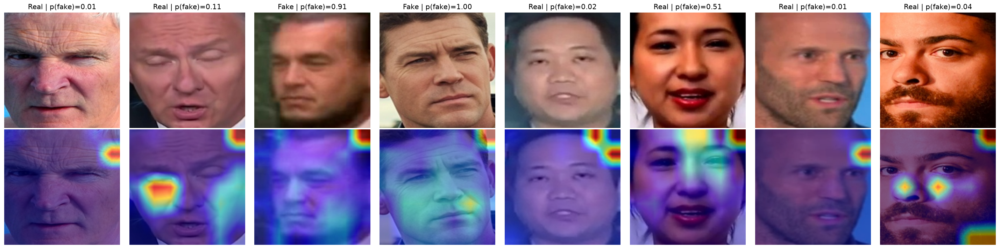

# DeepSentinel

Deepfake face detection with a fine-tuned EfficientNet-B4, evaluated on identity-disjoint splits and interpreted with Grad-CAM.



## Results

Held-out test set of 4,000 class-balanced images. None of the test identities appear in training or validation.

| Metric | Test |
|---|---|
| ROC AUC | **0.956** |
| Accuracy | 88.8% |
| Precision | 90.2% |
| Recall | 87.0% |
| F1 | 0.886 |

Best validation ROC AUC: 0.954 (epoch 5).

## Approach

- **Data:** [Deepfake Identity Isolated Dataset](https://huggingface.co/datasets/ThinothW/Deepfake-Identity-Isolated-Dataset-PreP) (CC BY 4.0), about 143K pre-cropped 260×260 face images with no identity overlap across splits. Training uses a class-balanced subset of 20K images.
- **Model:** ImageNet-pretrained EfficientNet-B4 (`timm`) with a single-logit head trained using binary cross-entropy.
- **Training:** AdamW, one-cycle learning rate schedule, mixed precision (FP16), border-removing center crops, and augmentation with random resized crops, flips, color jitter, Gaussian blur, and random erasing. Model selection is based on validation ROC AUC.
- **Interpretability:** Grad-CAM on the final convolutional layer to show which facial regions drive each prediction.
- **Robustness check:** Grad-CAM shows recurring activation in the top-right corner. Masking that region at test time leaves ROC AUC unchanged (0.9557 vs. 0.9554), confirming it is a boundary effect of the 7×7 feature map and not a learned shortcut.
- **Tracking:** Metrics, configuration, and Grad-CAM outputs are logged to Weights & Biases.

Training ran on a single NVIDIA GPU on Purdue's Scholar cluster and checkpoints every epoch, so interrupted runs resume automatically.

## Deployment

**REST API (FastAPI + Docker).** The `app/` package serves the model with OpenCV face detection, the same preprocessing used in evaluation, and optional Grad-CAM output.

```bash
docker build -t deepsentinel .
docker run -p 8000:8000 deepsentinel
curl -F "file=@face.jpg" "http://localhost:8000/predict?heatmap=true"
```

| Endpoint | Description |
|---|---|
| `GET /health` | Liveness and model status |
| `POST /predict` | Returns `label`, `p_fake`, the detected face box, and an optional base64 Grad-CAM PNG |
| `GET /docs` | Interactive OpenAPI documentation |

**AWS ECS (Fargate).** `deploy/deploy.sh` builds the image, pushes it to ECR, registers the task definition, and runs it as a public Fargate service. `deploy/teardown.sh` removes it.

**Hugging Face Spaces.** `space/` contains a Gradio demo that returns the prediction alongside a Grad-CAM overlay.

Model weights are hosted on the Hugging Face Hub and fetched at build time.

## Training

```bash
pip install -r requirements.txt
jupyter lab deepsentinel.ipynb
```

Set `DEEPSENTINEL_ROOT` to choose where checkpoints and outputs are written. Subset size, image resolution, and training hyperparameters are configured in the notebook's Configuration section. Set `N_TRAIN_PER_CLASS = None` to train on the full split.

## Repository Structure

```
deepsentinel/
├── deepsentinel.ipynb        # Training, evaluation, Grad-CAM, robustness check
├── app/
│   ├── inference.py          # Face detection, preprocessing, prediction, Grad-CAM
│   └── main.py               # FastAPI service
├── space/                    # Hugging Face Spaces Gradio demo
├── deploy/
│   ├── ecs-task-definition.json
│   ├── deploy.sh             # Build, push to ECR, deploy to ECS Fargate
│   └── teardown.sh
├── Dockerfile
├── requirements.txt          # Training
├── requirements-api.txt      # Inference
└── assets/
    └── gradcam.png
```

## Limitations

- The model is trained on still images, so it does not use temporal cues across video frames.
- Results come from a single dataset. Performance on unseen manipulation methods or other datasets has not been evaluated.
